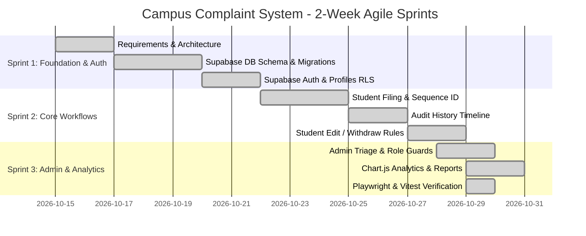

# Course Outcome 1 (CO1): Software Process Models

**Project Title:** Campus Complaint Management System  
**Academic Evaluation:** College Software Engineering (IA3 Practical Evaluation)  
**Implementation Technology:** React 19, Next.js 15 (App Router), TypeScript, Tailwind CSS, Supabase (PostgreSQL, Supabase Auth, Row-Level Security), Vitest, Playwright, Vercel  
*Legacy Foundation:* Python (Flask), SQLite, Bootstrap 5 (Preserved in `legacy_flask/`)

---

## 1. Problem Statement

Across college campuses, students frequently face infrastructural and operational difficulties involving classrooms (e.g., broken projectors, furniture, chalkboards), laboratories (e.g., faulty oscilloscopes, network drops, missing equipment), hostels (e.g., plumbing leaks, sanitation issues), power supply, Wi-Fi connectivity, drinking water dispensers, and transit facilities.

Traditionally, complaints are reported verbally to caretakers or through disparate, informal channels (such as paper registers, messaging groups, or word-of-mouth). This informal process leads to:
1. **Lack of Accountability:** Difficult to verify who received a complaint and who is responsible for fixing it.
2. **Zero Transparency:** Students have no tracking mechanism to know whether an issue is under review, scheduled for repair, or ignored.
3. **Operational Bottlenecks:** Campus administrators lack quantitative data on repeat failures, departmental bottlenecks, and resolution turnaround times.

The **Campus Complaint Management System** solves this by establishing a centralized, role-based digital web portal where students submit structured grievances, track live status progressions, and review administrative remarks. Administrators gain analytical dashboards to triage, assign, resolve, and monitor campus maintenance.

---

## 2. Project Objectives

1. **Centralized Digital Intake:** Provide an accessible web interface for reporting grievances across 10 official campus categories.
2. **Deterministic Complaint Tracking:** Automatically generate unique sequential tracking identifiers (`CMP-YYYY-XXXX`) for every submission using PostgreSQL database sequence triggers.
3. **End-to-End Audit Trail:** Maintain an immutable chronological status history table recording every status transition, actor identity, remarks, and timestamp.
4. **Role-Based Workflow Enforcement:** Enforce strict database-level boundaries between students (intake, tracking, initial withdrawal/edit) and administrators (assignment, priority adjustment, status advancement, resolution notes) via Supabase Row-Level Security (RLS).
5. **Persistent & Atomic Storage:** Store records in a PostgreSQL database with relational integrity and automatic triggers for user profile generation and timestamp tracking.
6. **Live Quantitative Analytics:** Compute real-time dashboard metrics (breakdowns by category, status, priority, and mean resolution turnaround hours) directly from database queries without hardcoded values.
7. **Empirical Verification:** Validate code quality and requirements through automated Vitest unit & integration tests and Playwright end-to-end browser workflows.

---

## 3. Target Users & Stakeholders

| User Role | Responsibilities & Capabilities | Key System Interfaces |
| :--- | :--- | :--- |
| **Student** | Registered college students who identify campus defects. Can register, log in, submit complaints, view personal filing history, filter by status, and edit/withdraw complaints while still in `Submitted` state. | Student Dashboard, Submit Complaint Form, My Complaints Directory, Complaint Details & History Timeline. |
| **Administrator** | Campus facility managers and departmental heads. Can inspect all campus submissions, search across students/keywords, assign complaints to specific technicians/departments, adjust priority, update status, record resolution notes, and reopen closed complaints if necessary. | Admin Dashboard, Visual Analytics (Chart.js), Complaints Directory, Admin Action Panel, Resolution Reports. |
| **Faculty & Department Staff** | Secondary beneficiaries assigned to rectify reported equipment or classroom infrastructure issues. | Departmental assignments surfaced via Admin Portal. |

---

## 4. Requirements Specification

### 4.1 Functional Requirements (FR)

- **FR-01 (Authentication):** The system shall authenticate students using student ID/email and password, and administrators using administrative credentials powered by Supabase Auth with secure JWT tokens and HTTP-only session cookies.
- **FR-02 (Unique Identification):** The system shall generate a unique sequential complaint ID formatted as `CMP-YYYY-XXXX` upon successful submission via database trigger `set_complaint_id()`.
- **FR-03 (Complaint Intake):** The system shall record title, description, category (10 official categories), campus location/building, department responsible, and priority.
- **FR-04 (Role-Based Authorization):** The system shall restrict administrative routes (`/admin/*`) strictly to accounts with `role='admin'`, redirecting students or returning HTTP 403 Forbidden.
- **FR-05 (Ownership Protection):** Students shall be strictly prohibited from viewing or modifying complaints submitted by other student accounts via PostgreSQL Row-Level Security policies.
- **FR-06 (Editing Restrictions):** A student shall be permitted to edit or withdraw a complaint only while its status remains in the initial `Submitted` state.
- **FR-07 (Administrative Triage):** Administrators shall be able to update status (`Submitted` &rarr; `Under Review` &rarr; `Assigned` &rarr; `In Progress` &rarr; `Resolved` &rarr; `Closed`, plus `Reopened`), reassign departments/technicians, and append resolution notes.
- **FR-08 (Audit History):** Every change to a complaint's status or assignment shall record an entry in `complaint_history` with the changer's user ID, name, old status, new status, remarks, and timestamp.
- **FR-09 (Search & Filtering):** The system shall provide multi-parameter filtering by category, status, priority, and department, alongside keyword searching across titles, locations, and descriptions.
- **FR-10 (Analytics & Reporting):** The system shall calculate live metrics including counts by status, counts by category, critical priority tallies, and mean resolution turnaround in hours.

### 4.2 Non-Functional Requirements (NFR)

- **NFR-01 (Security - SQL Injection):** All database interactions shall use parameterized Supabase client queries and PostgreSQL prepared statements to eliminate SQL injection vulnerabilities.
- **NFR-02 (Security - RBAC & RLS):** Database-level Row-Level Security (RLS) policies enforce authorization at the storage engine level, preventing unauthorized queries even if route handlers are bypassed.
- **NFR-03 (Security - Input Validation):** All client submissions and server route handlers shall be rigorously validated using Zod type-safe schemas.
- **NFR-04 (Usability & Responsiveness):** The frontend shall adapt responsively to mobile, tablet, and desktop viewports using Tailwind CSS utility classes and accessible UI components.
- **NFR-05 (Performance & Edge Deployment):** Next.js App Router utilizes React Server Components (RSC) to minimize client-side JavaScript bundle sizes and deploys instantly to Vercel edge networks.
- **NFR-06 (Portability):** The application runs seamlessly on Windows laptops via Node.js (`npm run dev`) and connects to cloud Supabase or local PostgreSQL instances.

---

## 5. Software Process Models Analysis

### 5.1 The Waterfall Model

The traditional **Waterfall model** is a sequential software development lifecycle (SDLC) consisting of distinct cascading phases:
1. Requirements Analysis &rarr; 2. System Design &rarr; 3. Implementation &rarr; 4. Integration & Testing &rarr; 5. Deployment &rarr; 6. Maintenance.

**Why Waterfall Was Inadequate for this Project:**
- In an academic IA3 timeline, campus user requirements evolve rapidly as faculty provide feedback regarding department classifications and priority levels.
- Waterfall prohibits revisiting earlier phases once code is written without costly change-order cycles.
- Testing is delayed until the end of the lifecycle, increasing the risk of architectural defects during deployment.

### 5.2 The Agile / Scrum Model

**Scrum** is an agile framework that delivers software incrementally in timeboxed iterations called **Sprints**. It emphasizes cross-functional teamwork, continuous testing, transparent auditability, and rapid stakeholder feedback.

**Why Scrum Was Chosen:**
1. **Iterative Feature Slicing:** Core authentication was completed first, followed by complaint filing, then administrative triage, and finally analytical charts.
2. **Early Verification:** Unit and integration tests ran at each sprint boundary using Vitest, guaranteeing regression-free status workflow transitions.
3. **Adaptive User Stories:** When faculty requested a `Reopened` status and formal resolution notes, the backlog was updated effortlessly within Sprint 2.

---

## 6. Scrum Sprint Plan

### Sprint Backlog Overview

| Sprint | Goal | User Stories Delivered | Velocity |
| :--- | :--- | :--- | :--- |
| **Sprint 1** | Foundation, Auth, and Database Engine | US-01 (Student Signup), US-02 (Secure Login), US-03 (RLS Schema) | 18 SP |
| **Sprint 2** | Student Complaint Lifecycle | US-04 (File Complaint), US-05 (Audit Trail), US-06 (Withdraw Ticket) | 24 SP |
| **Sprint 3** | Admin Triage, Analytics & Vercel Prep | US-07 (Admin Routing), US-08 (Live Charts), US-09 (Testing Suite) | 22 SP |

---

## 7. User Stories and Acceptance Criteria

### User Story 1 (Student Filing)
> **As a** college student,  
> **I want to** report a broken projector or facility defect through an online form,  
> **So that** maintenance staff are formally notified and assign a reference tracking number.

- **Acceptance Criteria:**
  1. Form requires title (min 5 chars), category, location, department, priority, and description (min 10 chars).
  2. System returns concurrent-safe identifier in format `CMP-YYYY-XXXX`.
  3. Status defaults to `Submitted` and initial entry is logged in `complaint_history`.

### User Story 2 (Administrative Triage)
> **As a** campus administrator,  
> **I want to** review incoming complaints, assign technicians, and advance workflow status,  
> **So that** maintenance progress is tracked and resolved systematically.

- **Acceptance Criteria:**
  1. Admin dashboard displays live counts for Pending, In Progress, Critical, and Resolved complaints.
  2. Status transitions follow valid sequence: `Submitted` &rarr; `Under Review` &rarr; `Assigned` &rarr; `In Progress` &rarr; `Resolved` &rarr; `Closed`.
  3. Every status advancement logs changer name, remarks, and timestamp to audit history.

---

## 8. Migration and Legacy Foundation

The project was originally prototyped in Python Flask and SQLite to establish basic relational structures and unit test harnesses. To achieve cloud scalability, edge rendering, role-level security, and seamless Vercel deployment, the codebase was migrated to **React 19, Next.js 15 App Router, TypeScript, and Supabase PostgreSQL**.

All legacy Flask implementation files, tests, and database models are preserved in the `legacy_flask/` directory for historical reference and IA3 evaluators.
