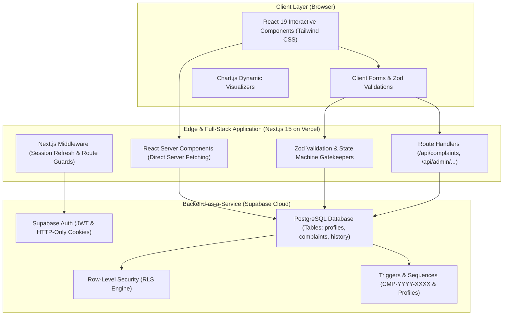
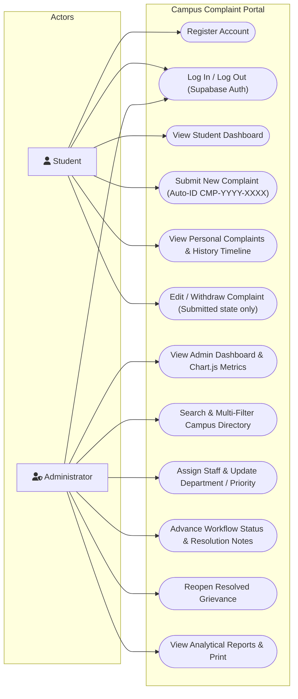
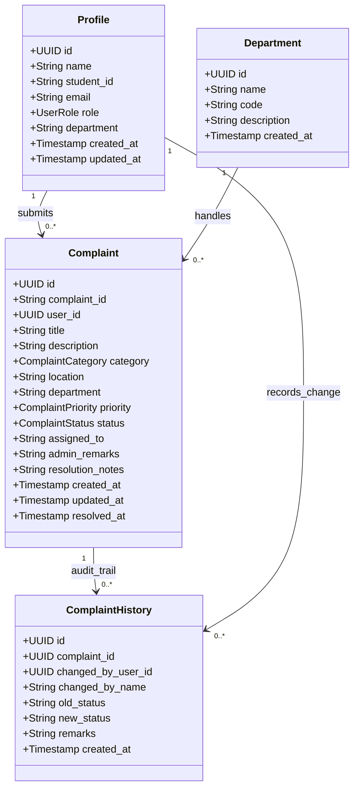
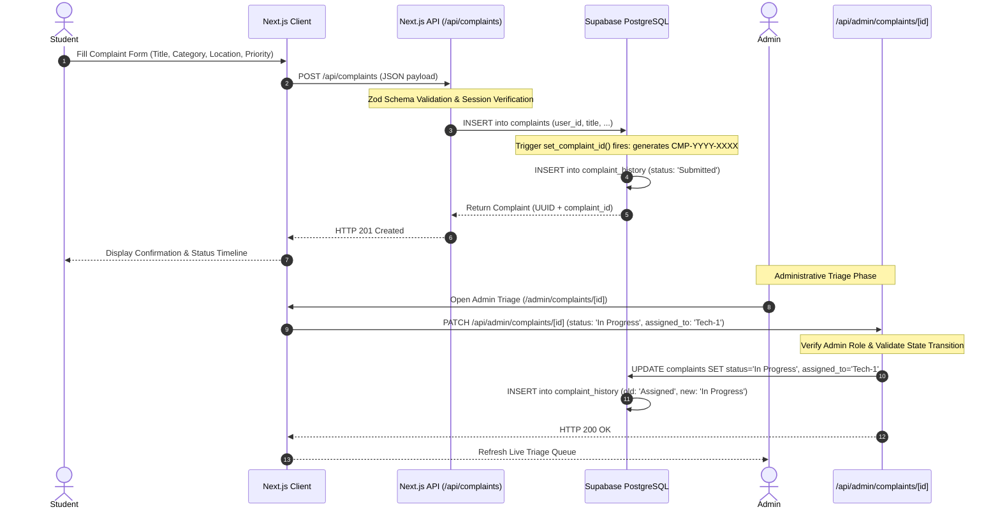
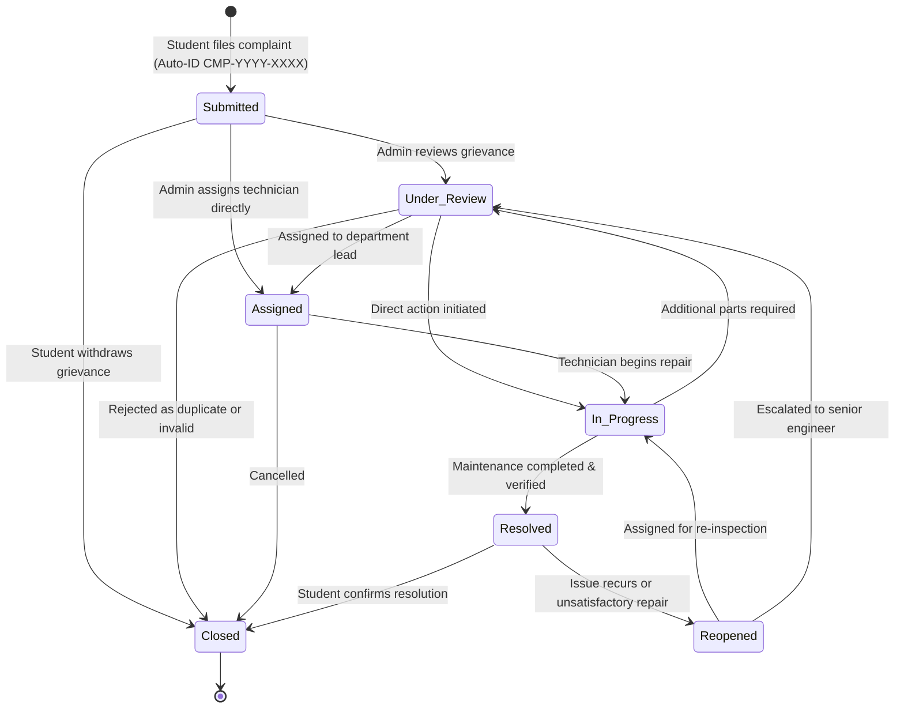

# Course Outcome 2 (CO2): UML Design & System Architecture

**Project Title:** Campus Complaint Management System  
**Academic Evaluation:** College Software Engineering (IA3 Practical Evaluation)  
**Implementation Technology:** React 19, Next.js 15 (App Router), TypeScript, Tailwind CSS, Supabase (PostgreSQL, Supabase Auth, Row-Level Security), Vitest, Playwright, Vercel  
*Legacy Foundation:* Python (Flask), SQLite, Bootstrap 5 (Preserved in `legacy_flask/`)

---

## 1. System Overview & Architecture

The **Campus Complaint Management System** is built on a modern **Full-Stack Next.js App Router & Serverless Architecture**:

- **Client Layer:** Modular React 19 components styled with Tailwind CSS utility classes. Includes client forms with validation, instant URL filter toolbars, and responsive status badges.
- **Server Component Layer (RSC):** Next.js App Router server components execute on the server, querying Supabase directly via server client with zero client-side data leaks.
- **API Route Handlers:** Next.js Route Handlers (`src/app/api/`) validate all incoming JSON mutations using Zod and enforce authorization boundaries.
- **Persistence & RLS Engine:** Supabase PostgreSQL database enforces referential integrity, automated sequence triggers (`set_complaint_id()`), and Row-Level Security (RLS) policies.

---

## 2. UML Diagrams

### 2.1 Use Case Diagram

---

### 2.2 Class Diagram (Data & Domain Models)

---

### 2.3 Sequence Diagram (Complaint Submission & Triage)

---

### 2.4 State Transition Machine Diagram (Complaint Lifecycle)

---

## 3. Database Relational Schema (PostgreSQL 4-Table Architecture)

| Table Name | Primary Key | Foreign Keys | Key Constraints & Policies |
| :--- | :--- | :--- | :--- |
| `public.profiles` | `id` (UUID) | References `auth.users(id)` | Cascading delete, RLS: Users can read/edit own profile; Admins can read all. |
| `public.departments`| `id` (UUID) | None | Unique `code` and `name`. Read public; Write admin only. |
| `public.complaints` | `id` (UUID) | `user_id` &rarr; `profiles(id)` | Unique `complaint_id` generated via trigger; RLS: Students select/insert own; Admins full access. |
| `public.complaint_history` | `id` (UUID) | `complaint_id` &rarr; `complaints(id)` | Immutable append-only audit trail; RLS: Visible to ticket owner and admins. |
