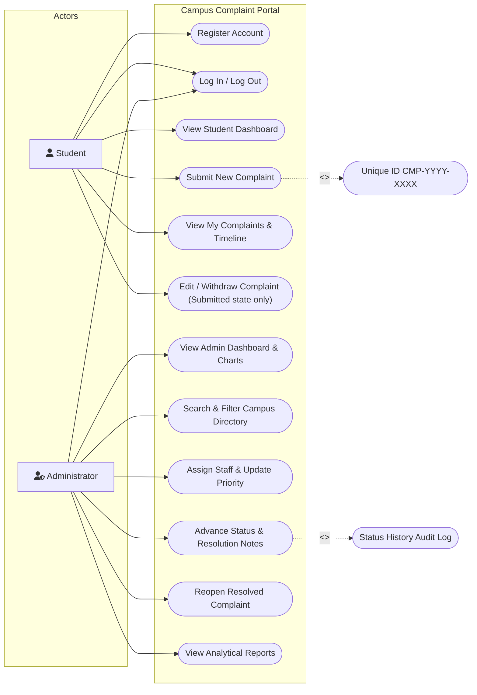
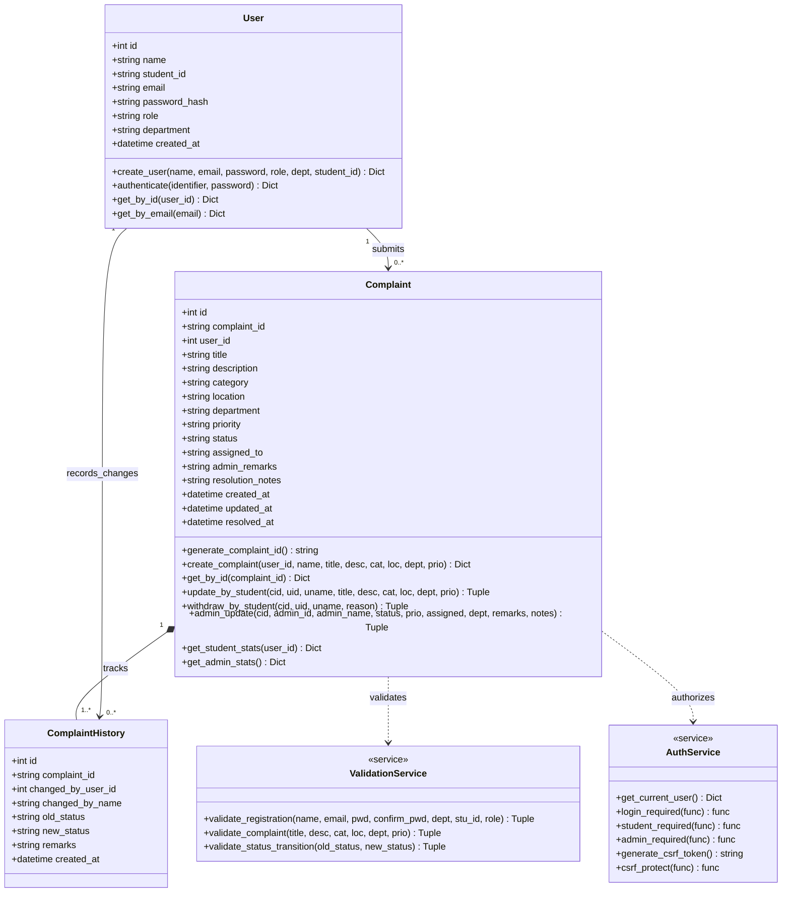
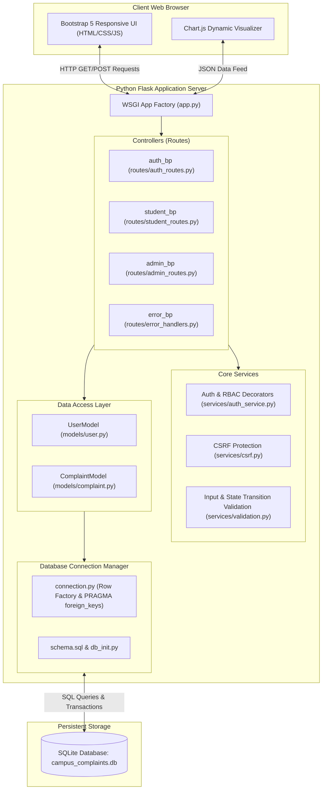
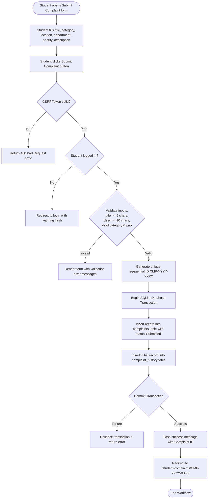
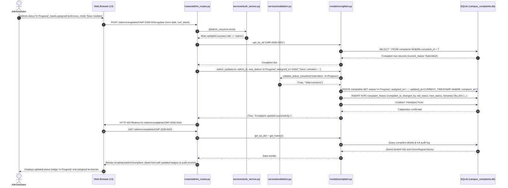

# Course Outcome 2 (CO2): UML Design & System Architecture

**Project Title:** Campus Complaint Management System  
**Academic Evaluation:** College Software Engineering (IA3 Practical Evaluation)  
**Implementation Technology:** Python (Flask), SQLite, HTML5, CSS3, JavaScript (Bootstrap 5), pytest, Selenium

---

## 1. System Overview & Architecture

The **Campus Complaint Management System** is built on a **Modular Model-View-Controller (MVC) architectural pattern** combined with a Service-Layer abstraction. 

- **Controller Layer (Flask Blueprints in `routes/`):** Manages HTTP routing, session inspection, and orchestrates request handling (`auth_routes.py`, `student_routes.py`, `admin_routes.py`, `error_handlers.py`).
- **Service Layer (`services/`):** Houses cross-cutting business logic, input validation (`validation.py`), session authorization decorators (`auth_service.py`), and CSRF token verification (`csrf.py`).
- **Model Layer (`models/`):** Encapsulates data persistence, parameterized SQL queries, password hashing, ID generation, and multi-table transactions (`user.py`, `complaint.py`).
- **View Layer (`templates/` and `static/`):** Renders responsive HTML5 views using Jinja2 templating, Bootstrap 5 styling, and Chart.js dynamic visualizations.
- **Persistence Layer (`database/`):** SQLite database engine enforcing referential integrity with foreign key constraints, default timestamps, and indexes.

---

## 2. UML Diagrams

### 2.1 Use Case Diagram

The Use Case representation below details the actor interactions for both **Student** and **Administrator** roles, showing clear boundaries and role separation.

#### Code Mapping:
- `UC1, UC2` are implemented in `routes/auth_routes.py` (`register()`, `login()`, `logout()`).
- `UC3, UC4, UC5, UC6` are implemented in `routes/student_routes.py` with ownership checks in `ComplaintModel.update_by_student()` and `ComplaintModel.withdraw_by_student()`.
- `UC7, UC8, UC9, UC10, UC11, UC12` are restricted to `role='admin'` via the `@admin_required` decorator in `services/auth_service.py` and implemented in `routes/admin_routes.py`.

---

### 2.2 Class Diagram

The class diagram below depicts the structural relationships between the model layer, service validators, and database entities.

#### Code Mapping:
- `User` corresponds to `models/user.py` (`UserModel`).
- `Complaint` corresponds to `models/complaint.py` (`ComplaintModel`).
- `ComplaintHistory` corresponds to records in SQLite table `complaint_history` inserted atomically inside `ComplaintModel` transactions.
- `ValidationService` corresponds to `services/validation.py`.
- `AuthService` corresponds to `services/auth_service.py` and `services/csrf.py`.

---

### 2.3 Component Diagram

The component diagram illustrates the high-level packaging and subsystem interactions.

---

### 2.4 Activity Diagram: Student Complaint Submission

The activity diagram below illustrates the exact workflow executed from the moment a student fills the complaint form to database persistence and history logging.

#### Code Mapping:
- Initiated in `templates/student/submit_complaint.html`.
- Handled in `routes/student_routes.py` (`submit_complaint()`).
- Atomic transaction implemented in `models/complaint.py` (`create_complaint()`).

---

### 2.5 Sequence Diagram: Administrator Complaint Resolution Workflow

The sequence diagram below shows the detailed interaction between the Administrator, the Web Controller, Service Validators, Data Models, and SQLite during a complaint status update and resolution note assignment.

---

## 3. UI Prototype Evolution & Screen-by-Screen Description

### 3.1 Initial Prototype Design vs. Final Implemented UI

During initial conception, a basic low-fidelity wireframe was planned. Below is the comparative evolution from that initial design to the final production implementation:

| Interface Component | Initial Wireframe Prototype | Final Implemented Interface | Usability & Functional Improvements |
| :--- | :--- | :--- | :--- |
| **Portal Landing Page** | Plain HTML text links to login. | Polished Hero Section with key value proposition badges, system feature highlights, and a quick-demonstration credential card. | Evaluators can immediately view credentials and test accounts without digging through terminal logs. |
| **Student Dashboard** | Simple table listing all complaints. | Stat Cards (Total, Submitted, In Progress, Resolved) with soft hover transitions, prominent "Submit New Complaint" CTA, and Recent Complaints summary table. | Immediate visual summary of active issues; one-click action to file new grievances. |
| **Complaint Details View** | Plain text readouts of complaint attributes. | Two-column responsive layout: Left column features rich metadata cards and prominent Admin Remarks/Resolution alert boxes; Right column features an elegant vertical CSS status audit timeline. | Clear separation between complaint content and administrative progress tracking. |
| **Admin Dashboard** | Basic count numbers and raw table. | High-level KPI metric cards, Critical priority indicator, mean resolution turnaround hours, interactive Chart.js Doughnut (categories) and Bar (statuses) graphs. | Administrators instantly spot departmental bottlenecks and repeat defect patterns visually. |
| **Search & Filters** | Single text input searching only IDs. | Multi-parameter filter bar combining keyword search (matching titles, IDs, locations, student names) with dropdown filters for category, department, priority, and status. | Facilitates granular triage during facility management audits. |

---

### 3.2 Screen-by-Screen Walkthrough

1. **Portal Home (`/` - `index.html`):** Welcomes users, describes the 10 grievance categories, and displays demonstration credentials for testing.
2. **Authentication Screens (`/login`, `/register`):**
   - Clean, centered Bootstrap cards with email/student ID input validation.
   - Prevents duplicate roll number and email registrations.
3. **Student Dashboard (`/student/dashboard`):** Real database statistics (Total, Submitted, In Progress, Resolved) and table of the student's 5 most recent submissions.
4. **Complaint Submission Screen (`/student/complaints/new`):** Dropdowns populated dynamically from configuration (`Config.COMPLAINT_CATEGORIES`, `Config.CAMPUS_DEPARTMENTS`, `Config.COMPLAINT_PRIORITIES`), with character counters and input guidelines.
5. **Student Complaint Detail (`/student/complaints/<id>`):** Full details, administrator resolution notes, status timeline, and conditionally rendered **Edit** and **Withdraw** buttons (rendered *only* when status is `Submitted`).
6. **Administrator Dashboard (`/admin/dashboard`):** Real-time database metrics, Chart.js category and status charts, and quick-action links to pending complaints.
7. **Administrator Complaints Directory (`/admin/complaints`):** Comprehensive search and filtering table displaying all campus grievances with quick links to manage.
8. **Administrator Action Screen (`/admin/complaints/<id>`):** Full student information panel, complaint body, and an administrative control card with status dropdowns, staff assignment fields, internal remarks, and public resolution notes.
9. **Analytical Reports Screen (`/admin/reports`):** Statistical breakdowns by category and department with percentage shares and a one-click browser print/export trigger (`window.print()`).
