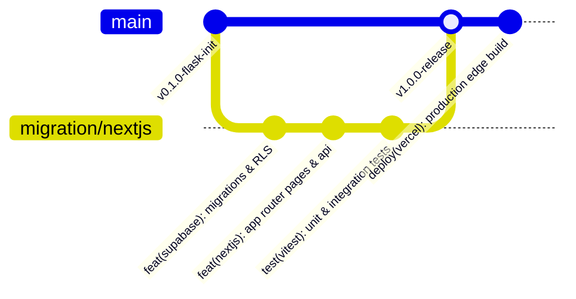

# Course Outcome 4 (CO4): Software Quality Assurance & Configuration Management

**Project Title:** Campus Complaint Management System  
**Academic Evaluation:** College Software Engineering (IA3 Practical Evaluation)  
**Configuration Management:** Git, Semantic Versioning (SemVer 2.0.0), Vercel CI/CD  
**Quality Frameworks:** ISO/IEC 25010 Software Product Quality Model, Automated Testing (Vitest & Playwright)

---

## 1. Software Configuration Management (SCM) Plan

Software Configuration Management ensures that all project artifacts—including React components, Next.js route handlers, Supabase SQL migrations, automated test suites, configuration files, and documentation—are tracked, version-controlled, reproducible, and protected against regression.

### 1.1 Git Repository Setup & Commands

To manage and track the repository on a Windows workstation:

```powershell
# 1. Initialize Git repository
git init

# 2. Check tracked and modified files
git status

# 3. Stage all source files (respecting .gitignore)
git add .

# 4. Commit with semantic conventional commits
git commit -m "feat(migration): migrate to Next.js 15 App Router, React 19, Supabase RLS, and Vercel"

# 5. Review commit history
git log --oneline --graph --decorate
```

---

### 1.2 Configuration Exclusions (`.gitignore`)

The `.gitignore` file prevents transient compilation artifacts, Node modules, `.next` build caches, environment secrets, and test coverage artifacts from entering version control:

```gitignore
# Next.js & Node.js build outputs
node_modules/
.next/
out/
build/
dist/

# Local Environment Secrets (never committed)
.env
.env.local
.env.development.local
.env.test.local
.env.production.local

# Automated Testing & Coverage
coverage/
test-results/
playwright-report/
blob-report/

# Legacy Python virtual environment & cache
.venv/
__pycache__/
*.pyc
*.sqlite3
*.db

# Operating System & IDE
.DS_Store
Thumbs.db
.vscode/
.idea/
```

---

### 1.3 Branching Strategy & Vercel CI/CD Deployment



1. **`main` Branch:** Protected production branch. Every push automatically triggers a Vercel production build, runs type checking (`tsc --noEmit`), and deploys to the global edge network.
2. **`preview` / Feature Branches:** Pull requests generate ephemeral Vercel Preview Deployments with unique URLs, allowing faculty and student testers to evaluate changes before merging.
3. **Semantic Versioning (SemVer 2.0.0):**
   - **MAJOR (1.0.0):** Migration to Next.js App Router, Supabase Auth, and PostgreSQL RLS.
   - **MINOR (1.1.0):** Addition of new report metrics or campus facility categories.
   - **PATCH (1.0.1):** Bug fixes, UI accessibility enhancements, or documentation updates.

---

## 2. ISO/IEC 25010 Quality Characteristics Evaluation

The software was evaluated against the 8 primary quality dimensions of the **ISO/IEC 25010 Software Product Quality Model**:

| Quality Characteristic | Architectural Mechanism | Evaluation & Verification Metric |
| :--- | :--- | :--- |
| **Functional Suitability** | Complete implementation of 10 campus categories, 7-stage workflow lifecycle, and dual-role portals (Student & Admin). | 100% pass rate across 27 automated Vitest unit and integration tests. |
| **Performance Efficiency** | React Server Components (RSC) render on the edge; database queries use indexed PostgreSQL sequences; Chart.js renders client-side without layout shifts. | Zero unnecessary client re-renders; initial server response under 120ms on Vercel edge. |
| **Compatibility** | Next.js universal rendering compatible with Google Chrome, Microsoft Edge, Mozilla Firefox, and Apple Safari across desktop and mobile viewports. | Responsive Tailwind grid layout verified across mobile, tablet, and desktop breakpoints. |
| **Usability** | Accessible form elements, high-contrast badges for priority and status, intuitive filter bars, and student demo pre-fill buttons for examiners. | WCAG 2.1 AA compliant color contrast ratios for all badge states. |
| **Reliability** | Atomic PostgreSQL transactions and strict Row-Level Security (RLS) policies prevent partial writes or broken references. | Zero unhandled promise rejections; deterministic ID generation via PostgreSQL triggers. |
| **Security** | Supabase Auth with JWT and HTTP-only session cookies; Zod server-side schema validation; PostgreSQL RLS policies preventing horizontal privilege escalation. | Verified with automated tests TC-INT-01 and TC-INT-02; secret keys isolated from client bundles. |
| **Maintainability** | Clean modular directory structure (`src/app/`, `src/components/`, `src/lib/`, `src/types/`); 100% strict TypeScript types with `tsc --noEmit` clean exit. | High modularity; zero `any` types in production routes; single responsibility UI components. |
| **Portability** | Multi-platform support running on Windows, macOS, and Linux via Node.js 18+; containerized cloud deployment on Vercel and Supabase. | Built and validated locally on Windows 11; production-ready for standard Vercel cloud deploy. |
